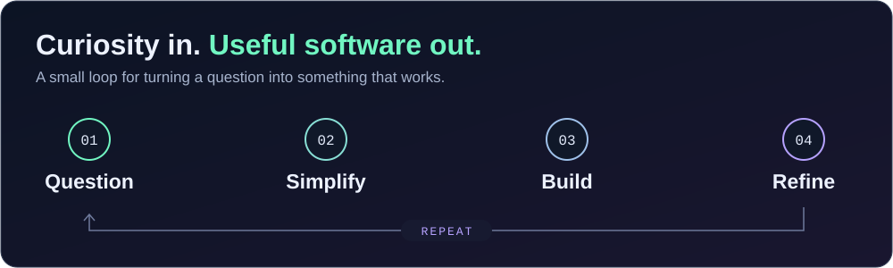

<p align="center">
  
</p>

<p align="center">
  <a href="https://github.com/zolateklu?tab=repositories"><strong>Explore my projects ↗</strong></a>
  &nbsp; · &nbsp;
  <a href="https://github.com/zolateklu/dependency-steward">Latest build</a>
  &nbsp; · &nbsp;
  <a href="https://github.com/zolateklu/Property-Management-AI-System">AI in practice</a>
</p>

<br />

### A little about the person behind the commits

Hi, I'm **Zelalem** — a **Senior Software Engineer** based in **Addis Ababa, Ethiopia**.

My projects connect interfaces, APIs, and automation: from mobile finance tools to AI-assisted property management and dependency upgrades. I like turning a complicated workflow into something clear, useful, and easy to follow.

```typescript
const zelalem = {
  handle: "@zolateklu",
  builds: ["full-stack applications", "mobile experiences", "AI workflows"],
  approach: "Make it useful. Make it clear. Make it reliable.",
};
```

### How I build

<p align="center">
  
</p>

**Start with the friction.** Find the step that feels harder than it should, then ask why.

**Make the next step obvious.** A clear interface and a thoughtful API are both ways of helping someone move forward.

**Keep learning from the result.** Ship something useful, listen, and make the next version better.

> Somewhere between “what if?” and “it works” is where I like to build.

<br />

<p align="center">
  <strong>Good software makes the next step feel simple.</strong><br />
  <sub>Thanks for stopping by. Pick a project, explore the code, and say hello in an issue or discussion where available.</sub>
</p>

<p align="center">
  
</p>
