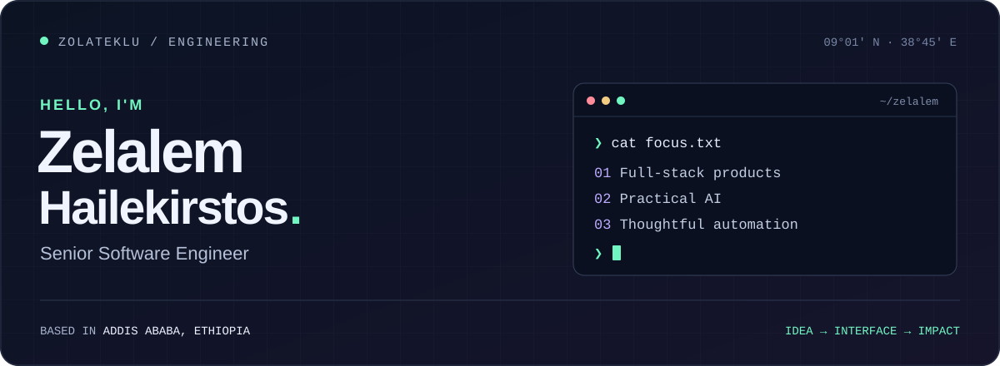
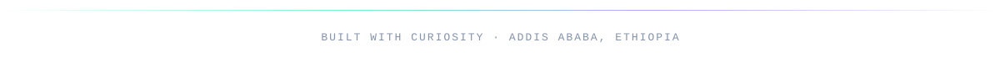

<p align="center">
  
</p>

<p align="center">
  <a href="https://github.com/zolateklu?tab=repositories"><strong>Explore my projects ↗</strong></a>
  &nbsp; · &nbsp;
  <a href="https://github.com/zolateklu/dependency-steward">Latest build</a>
  &nbsp; · &nbsp;
  <a href="https://github.com/zolateklu/Property-Management-AI-System">AI in practice</a>
</p>

<br />

### A little about the person behind the commits

Hi, I'm **Zelalem** — a **Senior Software Engineer** based in **Addis Ababa, Ethiopia**.

My projects connect interfaces, APIs, and automation: from mobile finance tools to AI-assisted property management and dependency upgrades. I like turning a complicated workflow into something clear, useful, and easy to follow.

```typescript
const zelalem = {
  handle: "@zolateklu",
  builds: ["full-stack applications", "mobile experiences", "AI workflows"],
  approach: "Make it useful. Make it clear. Make it reliable.",
};
```

### Selected builds

<table>
  <tr>
    <td width="50%" valign="top">
      <h3>01 / Dependency Steward</h3>
      <p>A dependency upgrade agent that validates changes in isolation, attempts a bounded compatibility repair, and prepares evidence-backed draft pull requests.</p>
      <p><code>Python</code> <code>React</code> <code>TypeScript</code> <code>Cloud Run</code></p>
      <a href="https://github.com/zolateklu/dependency-steward"><strong>Explore the agent ↗</strong></a>
    </td>
    <td width="50%" valign="top">
      <h3>02 / Property Management AI</h3>
      <p>Maintenance requests meet automated workflows: tenant conversations over WhatsApp, request routing, and a dashboard for property managers.</p>
      <p><code>Next.js</code> <code>Supabase</code> <code>n8n</code> <code>Twilio</code></p>
      <a href="https://github.com/zolateklu/Property-Management-AI-System"><strong>See the workflow ↗</strong></a>
    </td>
  </tr>
  <tr>
    <td width="50%" valign="top">
      <h3>03 / Finance Tracker</h3>
      <p>A finance project pairing a React Native / Expo client with a NestJS API and PostgreSQL. A look at my work across mobile and backend development.</p>
      <p><code>React Native</code> <code>Expo</code> <code>NestJS</code> <code>PostgreSQL</code></p>
      <a href="https://github.com/zolateklu/finance-tracker-frontend"><strong>Mobile app ↗</strong></a> &nbsp; · &nbsp;
      <a href="https://github.com/zolateklu/finance-tracker-backend"><strong>Backend ↗</strong></a>
    </td>
    <td width="50%" valign="top">
      <h3>04 / News Aggregator</h3>
      <p>A news aggregation project built with Next.js and TypeScript, bringing together an AI SDK and caching tools.</p>
      <p><code>Next.js</code> <code>TypeScript</code> <code>Redis</code> <code>Anthropic SDK</code></p>
      <a href="https://github.com/zolateklu/news-aggregator"><strong>Browse the source ↗</strong></a>
    </td>
  </tr>
</table>

### My working toolkit

| Layer | Tools I use in my projects |
| :--- | :--- |
| **Interfaces** | React · Next.js · React Native · Expo · Tailwind CSS |
| **APIs & data** | TypeScript · Python · NestJS · PostgreSQL · Supabase · Redis |
| **AI & automation** | Gemini · Anthropic SDK · n8n · GitHub Actions |
| **Delivery** | Google Cloud Run · Firestore · Docker · Vercel |

<br />

<p align="center">
  <strong>Good software makes the next step feel simple.</strong><br />
  <sub>Thanks for stopping by. Pick a project, explore the code, and say hello in an issue or discussion where available.</sub>
</p>

<p align="center">
  
</p>
